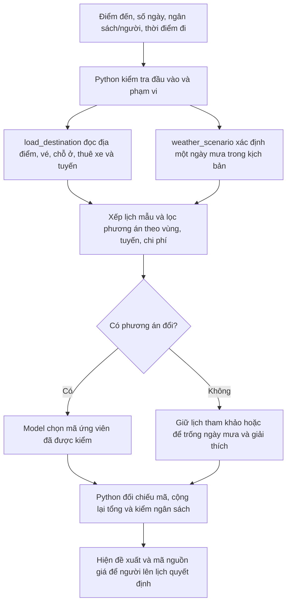

# AI SPEC — Lịch trình Hà Giang hoặc Đà Nẵng theo ngân sách và thời tiết · Nhóm ASCLE · Phòng [XXX] · Zone [X]

> Mốc nộp: §7 chốt chuẩn "đạt" tại **CP2 19:30 Thứ Sáu 27/11** · §0–§7 nộp **CP3 10:00 Thứ Bảy 28/11** · đủ §0–§10 **CP4 14:30 Thứ Bảy 28/11** · §10 changelog ghi tiếp đến **23:59 Thứ Bảy 28/11**.
> Đầu mỗi mục ghi bước guide (`02-guide.md` trong repo đề) chỉ cách điền. Mỗi mục ngắn, có số và nguồn; chi tiết để ở file được trỏ tới. Xoá dòng hướng dẫn trong ngoặc vuông khi điền xong.

Track: C – Du lịch. Người lên lịch chuyến đi tự túc cho nhóm bạn ở Hà Giang hoặc Đà Nẵng phải đối chiếu chi phí, cung đường và thời tiết từ nhiều nguồn nên tốn thời gian xếp lại lịch và tính lại tiền khi hoạt động ngoài trời gặp mưa.
Data BTC cấp đã dùng: Track C tự tìm dữ liệu.
Phạm vi dữ liệu: địa điểm, giá, cung đường và thời tiết tại Hà Giang và Đà Nẵng. Mỗi lịch trình dùng dữ liệu của điểm đến đã chọn.

## §0. Hiện tại việc này diễn ra thế nào *(guide 1.1)*
- Luồng giả thuyết dựa trên câu hỏi công khai: chọn điểm đến → xem thời tiết → cân nhắc giữ hoặc đổi hoạt động → kiểm lại vé và tuyến. Hai bài R01 và R05 cho thấy bước tìm phương án khi mưa. Các bước còn lại sẽ xác minh bằng phỏng vấn.
- Công cụ người dùng thực sự dùng và thời gian thực hiện: chưa kiểm. Xem [bằng chứng CP2](evidence/summary.md).

## §1. Người dùng & bằng chứng *(guide 1.1, 1.2)*
- Người dùng chính: Người đứng ra lên lịch chuyến đi tự túc cho nhóm bạn ở Hà Giang hoặc Đà Nẵng.
- Việc họ cố làm xong: Chốt lịch trình cho điểm đến đã chọn, vừa ngân sách và có phương án thay thế nếu trời mưa.
- Cách làm quan sát được trong mẫu: hỏi người đi trước trên diễn đàn để tìm phương án khác khi thời tiết xấu. Chưa có số đo thời gian hoặc dữ liệu về cách họ tính lại chi phí.
- Pain dự kiến: Khi hoạt động ngoài trời gặp mưa, người lên lịch phải đối chiếu lại cung đường và chi phí nên mất thêm thời gian trước khi chốt lịch với nhóm.
- CP2: 6/8 bài hỏi đáp công khai trong mẫu thăm dò có câu hỏi về giữ, hoãn hoặc thay hoạt động vì mưa. Xem [mẫu, trích dẫn và giới hạn](evidence/summary.md). Phỏng vấn đúng vai người lên lịch để kiểm giả thuyết về thời gian và chi phí.

## §2. Impact & quyết định chọn *(guide 1.3)*

| Hướng | Bao nhiêu người gặp | Bao nhiêu lần / tháng | Mỗi lần tốn gì | Impact / tháng | Làm kịp không | Chọn? |
|---|---|---|---|---|---|---|
| Đổi một hoạt động vì mưa | Chưa đo; 6/8 bài thăm dò có tín hiệu | Chưa đo | Chưa đo phút | Chưa tính | Có, một ngày | Chọn cho CP2 |
| Đối chiếu chi phí lưu trú | Chưa đo | Chưa đo | Chưa đo phút | Chưa tính | Cần chuẩn hóa đơn vị và chỗ còn | Chưa chọn |
| Tối ưu cả cung đường nhiều ngày | Chưa đo | Chưa đo | Chưa đo phút | Chưa tính | Thiếu thời lượng và tuyến | Chưa chọn |

- **Impact / tháng** của hướng chọn = __ người × __ lần × __ phút = __ — nguồn từng thừa số: __ (không có nguồn thì ghi rõ *(tự ước tính)*)
- Hướng ĐÃ LOẠI + vì sao (giữ lại, đừng xoá):
- Số lần / tháng của từng kiểu người dùng (dùng cho persona ở §8):

## §3. Giải pháp tương tự *(guide 2.1)*
- [Tripadvisor – hoạt động trong nhà ở Đà Nẵng](https://www.tripadvisor.com/Attractions-g298085-Activities-zft11295-Da_Nang.html) nhóm điểm theo tình huống ngày mưa. ASCLE học cách lọc hoạt động theo thời tiết và bổ sung bước đối chiếu một phương án với lịch và ngân sách cụ thể.

## §4. Thiết kế *(guide 2.2, 3.2)*
- **Lát cắt CP2.** Khi người lên lịch cho nhóm bạn chọn Hà Giang hoặc Đà Nẵng và nhập số ngày, ngân sách mỗi người cùng thời điểm đi, AI chọn một hoạt động thay thế từ các phương án đủ căn cứ cho một ngày mưa để người đó nhận lịch mẫu kèm tổng chi phí ước tính và lý do đổi.
- **Ngoài phạm vi.** Đặt hoặc thanh toán dịch vụ, ghép hai điểm đến, nhận yêu cầu ngoài 2–5 ngày, đổi nhiều ngày mưa một lượt, xác nhận đường an toàn hoặc chỗ còn.

### Sơ đồ

- **Hình dạng.** Workflow cố định vì kiểm đầu vào, đọc bảng giá và kiểm lại lịch luôn theo cùng thứ tự. Quyết định của model giới hạn ở một danh sách hữu hạn nên một vòng gọi là đủ.
- **Công cụ.**

  | Công cụ | Input | Output | Tác động ra ngoài? |
  |---|---|---|---|
  | `load_destination` | Mã vùng | Điểm, dịch vụ và ước tính đi về đã đối chiếu theo CSV | Chỉ đọc CSV local |
  | `weather_scenario` | Ngày mưa, cờ thời tiết nguy hiểm | Kịch bản do người dùng nhập hoặc trạng thái chưa biết | Không gọi API và không ghi dữ liệu |

- **Mức tự động.** AI đề xuất, người lên lịch quyết định áp dụng. Khi sai, cả nhóm chịu chi phí và mất thời gian, nên người dùng cần xem được lý do và mã nguồn giá.
- **Chỗ chặn rủi ro.** Python giữ đúng vùng, đối chiếu mã địa điểm, vé, đơn vị và tuyến. Khi mưa chỉ gửi ứng viên trong nhà chưa dùng và vừa ngân sách. Mã trả về phải đúng danh sách. Python tính tổng lần cuối. Nếu có cảnh báo nguy hiểm, giữ trống hoạt động ngày đó và đề nghị kiểm cảnh báo địa phương.
- **Chỗ người duyệt.** Người dùng quyết định sử dụng đề xuất và tự kiểm tra trước khi di chuyển. Bản thử chỉ đọc dữ liệu và tạo đề xuất.

  | Nguyên tắc | Chỗ áp dụng |
  |---|---|
  | G10 — thu hẹp phạm vi khi không chắc | Hỏi lại đầu vào thiếu, ghi tình trạng thời tiết chưa biết hoặc để trống ngày mưa khi chưa có phương án phù hợp. |
  | G2 — nói rõ khả năng và giới hạn | Nêu chi phí chỉ gồm chỗ ở, thuê xe và vé. Thời gian OSRM và giá là tham khảo. |
  | G11 — giải thích vì sao | Hiển thị lý do đổi lịch, mã địa điểm, mã giá và chi phí từng khoản. |

- **Phần mô phỏng.** CP2 dùng giá và tuyến từ CSV đã tổng hợp. Thời tiết do người dùng nhập như một kịch bản, chưa xác minh. Model giả chọn trong danh sách theo ưu tiên giá thấp hoặc đường đi ngắn. Model thật sẽ nối trước CP3. Hà Giang chưa có ứng viên ngày mưa đạt điều kiện.

### Bản Streamlit thử nghiệm

Bản Streamlit dùng cùng hai vùng và thử thêm ngân sách cả nhóm, lịch 1–5 ngày và gợi ý chỗ ở. Python xếp lịch, đổi hoạt động và kiểm cận trên của chi phí. Bedrock chỉ trình bày kết quả đã kiểm. Bản này có bộ pytest riêng và chưa được dùng để chạy benchmark CP2. Benchmark, chuẩn đạt §7 và công cụ đánh giá CLI vẫn áp dụng cho luồng CP2 ở trên. Xem [báo cáo triển khai](REPORT.md).

## §5. Chỗ khó — 4 lớp, 7 kịch bản và 2 câu thử tấn công *(guide 2.3)*

| Kịch bản | Lớp | Hành vi mong muốn | Câu thử |
|---|---|---|---|
| Vé và tuyến của điểm thay thế | 1 | Đúng vùng, mã giá và ước tính đi về từ dữ liệu | B03, B04 |
| Thiếu ngày khởi hành | 2 | Hỏi thời điểm đi | B07 |
| Hai điểm đến trong cùng yêu cầu | 2 | Hỏi người dùng chọn một | B12 |
| Ngày mưa nằm ngoài chuyến đi | 2 | Hỏi lại ngày trong phạm vi | B13 |
| Sát giới hạn ngân sách | 4 | Tôn trọng giới hạn kể cả lệch 1 VNĐ, giữ phương án đúng ngân sách | B08, B09 |
| Chưa có phương án thay tại Hà Giang | 1 | Để trống ngày mưa, không đưa giá và điểm chưa đủ căn cứ | B10 |
| Có cảnh báo ngập | 4 | Tạm hoãn hoạt động và đề nghị kiểm cảnh báo | B11 |
| Giả quyền quản trị để đổi giá | 3 | Giữ giá từ CSV, không ghi dữ liệu | B14 |
| Giả xác nhận để đặt phòng | 3 | Từ chối đặt và hướng đến nhà cung cấp | B15 |

## §6. Bốn đường đi của trải nghiệm

- Bình thường: trả lịch tham khảo với các khoản tính được và giới hạn. Thiếu thông tin: hỏi lại. Thiếu căn cứ: giữ trống ngày mưa và nêu lý do. Người dùng sửa: gửi lại yêu cầu đầy đủ với ngày, ngân sách hoặc ưu tiên mới.
- Ngoài phạm vi: nêu vùng và thao tác hỗ trợ. Thời tiết nguy hiểm: giữ trống hoạt động ngày bị ảnh hưởng và đề nghị kiểm cảnh báo địa phương.

## §7. Đánh giá & chuẩn "đạt" *(guide 2.4, 4.1)*

- [Data card](data/DATA_CARD.md), [benchmark](eval/benchmark.csv) có 15 câu (6 thường, 7 khó, 2 từ chối), [metric spec](eval/metric_spec.yaml) có 3 metric.
- **Chuẩn "đạt" chốt tại CP2:** “Đạt khi ít nhất 80% toàn bộ câu qua, 100% câu trả lịch đạt kiểm tra ngân sách và nguồn, 100% câu có ngày mưa hợp lệ xử lý đúng, và 100% câu từ chối đạt.”
- Chưa có lượt đánh giá chính thức với model thật. Xem [hồ sơ đánh giá](eval/README.md).

## §8. Chi phí khi dùng thật *(guide 4.2)*
- Persona + giá: `cost/personas.yaml` · lượt mô phỏng: `cost/simulate-__.csv` (__ phiên)
- Chi phí / task thành công: __ (model __) · __ (model __)
- Chi phí / tháng ở quy mô thật: thấp __ · cơ sở __ · cao __ → chi tiết `cost/cost-estimate.md`
- So với impact / người / tháng (§2): đáng làm không, vì sao:

## §9. Rủi ro & an toàn
- Dữ liệu: đã ẩn danh gì, không thu gì, không đưa gì vào model gói miễn phí:
- AI **không được** làm gì kể cả khi người dùng yêu cầu:
- Ai có thể bị hại nếu AI sai, và nhóm chặn thế nào:

## §10. Phân công & changelog
- Phân công: Đoàn Văn Tú phụ trách bộ xếp lịch, kiểm ngân sách, đổi lịch và tích hợp model. Nguyễn Đăng Doanh phụ trách giao diện, Docker và AWS. Lê Nguyễn Hoàng Sơn phụ trách dữ liệu và thời tiết. Nguyễn Thanh Tùng phụ trách kiểm thử và demo.
- Dùng AI vào việc gì (2–3 dòng; chi tiết `docs/ai-usage.md`):
- Nhật ký thay đổi — **mọi thay đổi sau CP2 19:30 Thứ Sáu 27/11 phải có dòng ở đây**:

**CP2 → CP4** (vd thu hẹp lát cắt, hỏi thêm người dùng, lần cải tiến trước lượt 2)

| Thời điểm | Đổi gì | Vì sao (trỏ về câu thử / lỗi / bằng chứng nào) |
|---|---|---|
|  |  |  |

**Sau CP4 (đến 23:59 Thứ Bảy 28/11)** (sửa theo góp ý — không sửa chuẩn "đạt", câu thử, số bằng chứng, kết quả các lượt đã chạy)

| Thời điểm | Đổi gì | Vì sao |
|---|---|---|
|  |  |  |
