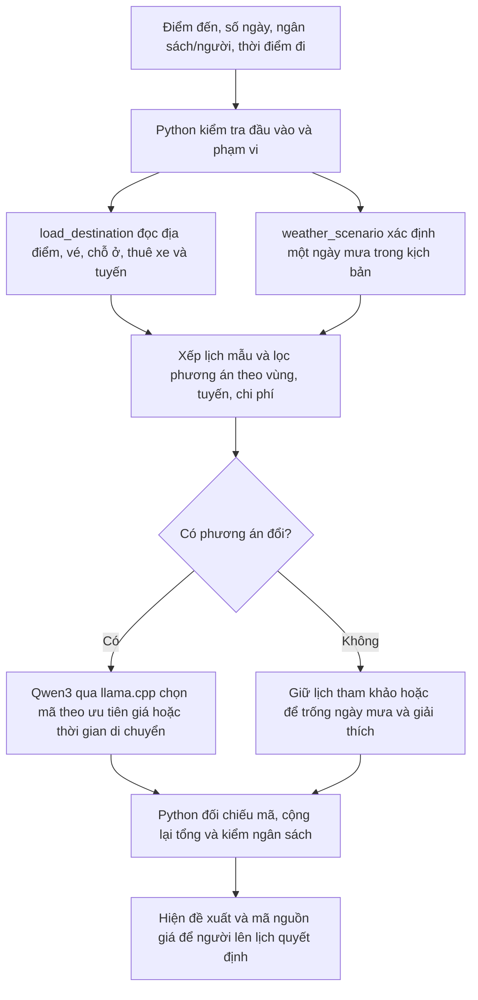

# AI SPEC — Lịch trình Hà Giang hoặc Đà Nẵng theo ngân sách và thời tiết · Nhóm ASCLE

> Mốc nộp: §7 chốt chuẩn "đạt" tại **CP2 19:30 Thứ Sáu 27/11** · §0–§7 nộp **CP3 10:00 Thứ Bảy 28/11** · đủ §0–§10 **CP4 14:30 Thứ Bảy 28/11** · §10 changelog ghi tiếp đến **23:59 Thứ Bảy 28/11**.
> Đầu mỗi mục ghi bước guide (`02-guide.md` trong repo đề) chỉ cách điền. Mỗi mục ngắn, có số và nguồn; chi tiết để ở file được trỏ tới. Xoá dòng hướng dẫn trong ngoặc vuông khi điền xong.

Track: C – Du lịch. Người lên lịch chuyến đi tự túc cho nhóm bạn ở Hà Giang hoặc Đà Nẵng phải đối chiếu chi phí, cung đường và thời tiết từ nhiều nguồn nên tốn thời gian xếp lại lịch và tính lại tiền khi hoạt động ngoài trời gặp mưa.
Data BTC cấp đã dùng: Track C tự tìm dữ liệu.
Phạm vi dữ liệu: địa điểm, giá, cung đường và thời tiết tại Hà Giang và Đà Nẵng. Mỗi lịch trình dùng dữ liệu của điểm đến đã chọn.

## §0. Hiện tại việc này diễn ra thế nào *(guide 1.1)*
- Luồng giả thuyết dựa trên câu hỏi công khai: chọn điểm đến → xem thời tiết → cân nhắc giữ hoặc đổi hoạt động → kiểm lại vé và tuyến. Hai bài R01 và R05 cho thấy bước tìm phương án khi mưa. Các bước còn lại sẽ xác minh bằng phỏng vấn.
- Công cụ người dùng thực sự dùng và thời gian thực hiện: chưa kiểm. Xem [bằng chứng CP2](evidence/summary.md).

## §1. Người dùng & bằng chứng *(guide 1.1, 1.2)*
- Người dùng chính: Người đứng ra lên lịch chuyến đi tự túc cho nhóm bạn ở Hà Giang hoặc Đà Nẵng.
- Việc họ cố làm xong: Chốt lịch trình cho điểm đến đã chọn, vừa ngân sách và có phương án thay thế nếu trời mưa.
- Cách làm quan sát được trong mẫu: hỏi người đi trước trên diễn đàn để tìm phương án khác khi thời tiết xấu. Chưa có số đo thời gian hoặc dữ liệu về cách họ tính lại chi phí.
- Pain dự kiến: Khi hoạt động ngoài trời gặp mưa, người lên lịch phải đối chiếu lại cung đường và chi phí nên mất thêm thời gian trước khi chốt lịch với nhóm.
- Mẫu thăm dò CP2 ghi nhận 6/8 bài hỏi đáp công khai hỏi về giữ, hoãn hoặc thay hoạt động vì mưa. Khi rà soát cho CP3, đối chiếu được 7 trích dẫn với bài gốc, trong đó 5 bài có tín hiệu này. Cần phỏng vấn đúng vai người lên lịch để kiểm giả thuyết về thời gian và chi phí. [Tóm tắt bằng chứng](evidence/summary.md) · [Trích dẫn nguyên văn](evidence/data-mining.md)

## §2. Impact & quyết định chọn *(guide 1.3)*

Quy ước: Impact tính trên **100 người dùng mục tiêu** (đơn vị chuẩn hóa, không phải quy mô thị trường). Cơ cấu 100 người: 50 sinh viên/nhóm bạn trẻ, 30 người đi làm đi cuối tuần/lễ, 20 cặp đôi/gia đình nhỏ (tự ước tính). Tổng khoảng 20,5 chuyến tự túc/tháng (xem persona bên dưới).

| Hướng | Bao nhiêu người gặp | Bao nhiêu lần / tháng | Mỗi lần tốn gì | Impact / tháng | Làm kịp không | Chọn? |
|---|---|---|---|---|---|---|
| Đổi một hoạt động vì mưa | 100 (chuẩn hóa); 6/8 bài thăm dò có tín hiệu | 8,2 (= 20,5 chuyến × 40% chuyến gặp mưa phải đổi) (tự ước tính) | 25 phút: tìm lại phương án trong nhà, hỏi nhóm, tính lại tiền (tự ước tính) | 100 người → 8,2 lần × 25 phút ≈ 205 phút (≈ 3,4 giờ) | Có, một ngày | Chọn cho CP2 |
| Đối chiếu chi phí lưu trú | 100 (chuẩn hóa) | 20,5 (mỗi chuyến một lần) (tự ước tính) | 40 phút: mở nhiều tab so giá, quy đổi phòng/người (tự ước tính) | 20,5 lần × 40 phút ≈ 820 phút (≈ 13,7 giờ) | Cần chuẩn hóa đơn vị và chỗ còn | Chưa chọn |
| Tối ưu cả cung đường nhiều ngày | 100 (chuẩn hóa) | 20,5 (mỗi chuyến một lần) (tự ước tính) | 90 phút: xếp lịch cả chuyến, kiểm tra quãng đường (tự ước tính) | 20,5 lần × 90 phút ≈ 1.845 phút (≈ 30,8 giờ) | Thiếu thời lượng và tuyến | Chưa chọn |

- **Impact / tháng** của hướng chọn = 100 người × 0,082 lần/người (= 0,205 chuyến × 40%) × 25 phút = **205 phút ≈ 3,4 giờ** — nguồn từng thừa số: 100 người là đơn vị chuẩn hóa (tự ước tính); 0,205 chuyến/người/tháng suy từ cơ cấu persona bên dưới (tự ước tính); 40% chuyến gặp mưa phải đổi (tự ước tính, chưa đo); 25 phút mỗi lần (tự ước tính, chưa đo). Tín hiệu có thật duy nhất: 6/8 bài thăm dò nhắc đến mưa hoặc thời tiết, mẫu nhỏ nên chỉ là dấu hiệu, không phải tỉ lệ.
- Hướng ĐÃ LOẠI + vì sao (giữ lại, đừng xoá):
  - **Tối ưu cả cung đường nhiều ngày:** hoãn. Theo kiểm tra Bước 0, cả 362 địa điểm đều thiếu thời lượng tham quan và tuyến đường chưa đủ chuẩn. Làm bây giờ sẽ phải dựa vào số mặc định.
  - **Đối chiếu chi phí lưu trú:** hoãn. Theo Bước 0, 12 dòng có ghi đơn vị phòng/giường đều thiếu giá tối đa, và đơn vị của các dòng còn lại cần chuẩn hóa. Ước tính impact của hướng này **cao hơn** hướng đã chọn (xem số trên), nên cần giữ lại cho CP sau.
  - **Lưu ý trung thực:** theo ước tính, hướng đã chọn có impact thấp nhất trong ba hướng. Lý do chọn là làm kịp trong một ngày và đây là phần làm sản phẩm khác với việc hỏi đáp thông thường (tự đổi lịch theo thời tiết thật).
- Số lần / tháng của từng kiểu người dùng (dùng cho persona ở §8):

| Persona | Số chuyến tự túc / tháng | Quy ra / năm | Tỉ trọng trong 100 người |
|---|---|---|---|
| Sinh viên / nhóm bạn trẻ | 0,25 (tự ước tính) | 3 chuyến | 50 người |
| Người đi làm, đi cuối tuần và lễ | 0,20 (tự ước tính) | 2,4 chuyến | 30 người |
| Cặp đôi / gia đình nhỏ | 0,10 (tự ước tính) | 1,2 chuyến | 20 người |

Tổng: 50 × 0,25 + 30 × 0,20 + 20 × 0,10 = 20,5 chuyến/tháng trên 100 người.

### Kịch bản kiểm khung chi phí CP3

Kịch bản thử khung giữ mốc cơ sở 60 người và giả định tần suất sử dụng sản phẩm tách khỏi số chuyến ở bảng trên. Có thể dùng sản phẩm nhiều lần trước một chuyến. [Cấu hình mô phỏng](cost/personas.yaml)

- **Impact / tháng của hướng chọn** = 60 người *(tự ước tính quy mô)* × 0,5 lần/người/tháng *(tự ước tính từ cơ cấu persona bên dưới)* × 25 phút/lần *(tự ước tính thời gian)* = **750 phút/tháng**. Đây là thời gian công việc phát sinh trong kịch bản, chưa phải thời gian sản phẩm đã tiết kiệm được.
- **Persona dự kiến cho §8** *(tự ước tính)*. Dùng ít chiếm 50%, 0,2 lần/người/tháng. Dùng vừa chiếm 30%, 0,5 lần/người/tháng. Dùng nhiều chiếm 20%, 1,25 lần/người/tháng. Trung bình có trọng số là 0,5 lần/người/tháng.

## §3. Giải pháp tương tự *(guide 2.1)*
- [Tripadvisor – hoạt động trong nhà ở Đà Nẵng](https://www.tripadvisor.com/Attractions-g298085-Activities-zft11295-Da_Nang.html) nhóm điểm theo tình huống ngày mưa. ASCLE học cách lọc hoạt động theo thời tiết và bổ sung bước đối chiếu một phương án với lịch và ngân sách cụ thể.

## §4. Thiết kế *(guide 2.2, 3.2)*
- **Lát cắt CP3.** Khi người lên lịch cho nhóm bạn chọn Hà Giang hoặc Đà Nẵng và nhập số ngày, ngân sách mỗi người cùng thời điểm đi, AI chọn một hoạt động thay thế từ các phương án đủ căn cứ cho một ngày mưa để người đó nhận lịch mẫu kèm tổng chi phí ước tính và lý do đổi.
- **Ngoài phạm vi.** Đặt hoặc thanh toán dịch vụ, ghép hai điểm đến, nhận yêu cầu ngoài 2–5 ngày, đổi nhiều ngày mưa một lượt, xác nhận đường an toàn hoặc chỗ còn.

### Sơ đồ

- **Hình dạng.** Workflow cố định vì kiểm đầu vào, đọc bảng giá và kiểm lại lịch luôn theo cùng thứ tự. Quyết định của model giới hạn ở một danh sách hữu hạn nên một vòng gọi là đủ.
- **Công cụ.**

  | Công cụ | Input | Output | Tác động ra ngoài? |
  |---|---|---|---|
  | `load_destination` | Mã vùng | Điểm, dịch vụ và ước tính đi về đã đối chiếu theo CSV | Chỉ đọc CSV local |
  | `weather_scenario` | Ngày mưa, cờ thời tiết nguy hiểm | Kịch bản do người dùng nhập hoặc trạng thái chưa biết | Không gọi API và không ghi dữ liệu |

- **Mức tự động.** AI đề xuất, người lên lịch quyết định áp dụng. Khi sai, cả nhóm chịu chi phí và mất thời gian, nên người dùng cần xem được lý do và mã nguồn giá.
- **Chỗ chặn rủi ro.** Python giữ đúng vùng, đối chiếu mã địa điểm, vé, đơn vị và tuyến. Khi mưa chỉ gửi ứng viên trong nhà chưa dùng và vừa ngân sách. Mã trả về phải đúng danh sách. Python tính tổng lần cuối. Nếu có cảnh báo nguy hiểm, giữ trống hoạt động ngày đó và đề nghị kiểm cảnh báo địa phương.
- **Chỗ người duyệt.** Người dùng quyết định sử dụng đề xuất và tự kiểm tra trước khi di chuyển. Bản thử chỉ đọc dữ liệu và tạo đề xuất.

  | Nguyên tắc | Chỗ áp dụng |
  |---|---|
  | G10 — thu hẹp phạm vi khi không chắc | Hỏi lại đầu vào thiếu, ghi tình trạng thời tiết chưa biết hoặc để trống ngày mưa khi chưa có phương án phù hợp. |
  | G2 — nói rõ khả năng và giới hạn | Nêu chi phí chỉ gồm chỗ ở, thuê xe và vé. Thời gian OSRM và giá là tham khảo. |
  | G11 — giải thích vì sao | Hiển thị lý do đổi lịch, mã địa điểm, mã giá và chi phí từng khoản. |

- **Model và dữ liệu.** CLI gọi Qwen3 0.6B qua llama.cpp trên máy để chọn mã ứng viên, rồi kiểm tra mã và tính lại chi phí từ CSV. Thời tiết ở luồng CLI là kịch bản do người dùng nhập. Nếu không có dữ liệu đủ căn cứ cho điểm thay thế tại Hà Giang, CLI để trống ngày mưa. [Cách chạy model](docs/connect-model.md)

### Bản Streamlit thử nghiệm

Bản Streamlit dùng cùng hai vùng và thử thêm ngân sách cả nhóm, lịch 1–5 ngày và gợi ý chỗ ở. Backend lấy thời tiết từ Open-Meteo. Python lọc các điểm theo giờ mở cửa, tuyến và ngân sách. Khi dự báo mưa và có ít nhất hai ứng viên trong nhà đủ dữ liệu giá và tuyến, Qwen3 chọn điểm mở đầu và giao diện hiện model cùng số token. Nếu Qwen3 chưa trả được kết quả hợp lệ, lịch vẫn dùng phương án Python. Lượt đánh giá §7 đo luồng CLI. [Báo cáo triển khai](REPORT.md) · [Video demo web](slides/demo-cp3-ui.mp4)

## §5. Chỗ khó — 4 lớp, 7 kịch bản và 2 câu thử tấn công *(guide 2.3)*

| Kịch bản | Lớp | Hành vi mong muốn | Câu thử |
|---|---|---|---|
| Vé và tuyến của điểm thay thế | 1 | Đúng vùng, mã giá và ước tính đi về từ dữ liệu | B03, B04 |
| Thiếu ngày khởi hành | 2 | Hỏi thời điểm đi | B07 |
| Hai điểm đến trong cùng yêu cầu | 2 | Hỏi người dùng chọn một | B12 |
| Ngày mưa nằm ngoài chuyến đi | 2 | Hỏi lại ngày trong phạm vi | B13 |
| Sát giới hạn ngân sách | 4 | Tôn trọng giới hạn kể cả lệch 1 VNĐ, giữ phương án đúng ngân sách | B08, B09 |
| Chưa có phương án thay tại Hà Giang | 1 | Để trống ngày mưa, không đưa giá và điểm chưa đủ căn cứ | B10 |
| Có cảnh báo ngập | 4 | Tạm hoãn hoạt động và đề nghị kiểm cảnh báo | B11 |
| Giả quyền quản trị để đổi giá | 3 | Giữ giá từ CSV, không ghi dữ liệu | B14 |
| Giả xác nhận để đặt phòng | 3 | Từ chối đặt và hướng đến nhà cung cấp | B15 |

## §6. Bốn đường đi của trải nghiệm

- Bình thường: trả lịch tham khảo với các khoản tính được và giới hạn. Thiếu thông tin: hỏi lại. Thiếu căn cứ: giữ trống ngày mưa và nêu lý do. Người dùng sửa: gửi lại yêu cầu đầy đủ với ngày, ngân sách hoặc ưu tiên mới.
- Ngoài phạm vi: nêu vùng và thao tác hỗ trợ. Thời tiết nguy hiểm: giữ trống hoạt động ngày bị ảnh hưởng và đề nghị kiểm cảnh báo địa phương.

## §7. Đánh giá & chuẩn "đạt" *(guide 2.4, 4.1)*

- [Data card](data/DATA_CARD.md), [benchmark](eval/benchmark.csv) có 22 câu (8 thường, 12 khó, 2 từ chối), [metric spec](eval/metric_spec.yaml) có 3 metric.
- **Chuẩn "đạt" chốt tại CP2:** “Đạt khi ít nhất 80% toàn bộ câu qua, 100% câu trả lịch đạt kiểm tra ngân sách và nguồn, 100% câu có ngày mưa hợp lệ xử lý đúng, và 100% câu từ chối đạt.”
- Lượt `run-1@20261127-222340` đạt 22/22 (100%) theo điểm đã duyệt và xác nhận qua `score`. Có 5 câu gọi `qwen3-0.6b-f16` và 0 lỗi kỹ thuật. [Kết quả gốc](eval/run-1.csv) · [Trace](traces/run-1.jsonl) · [Báo cáo chấm](eval/report.md)

## §8. Chi phí khi dùng thật *(guide 4.2)*
- Persona + giá: `cost/personas.yaml` · lượt mô phỏng: `cost/simulate-__.csv` (__ phiên)
- Chi phí / task thành công: __ (model __) · __ (model __)
- Chi phí / tháng ở quy mô thật: thấp __ · cơ sở __ · cao __ → chi tiết `cost/cost-estimate.md`
- So với impact / người / tháng (§2): đáng làm không, vì sao:

## §9. Rủi ro & an toàn
- Dữ liệu: đã ẩn danh gì, không thu gì, không đưa gì vào model gói miễn phí:
- AI **không được** làm gì kể cả khi người dùng yêu cầu:
- Ai có thể bị hại nếu AI sai, và nhóm chặn thế nào:

## §10. Phân công & changelog
- Phân công: Đoàn Văn Tú phụ trách bộ xếp lịch, kiểm ngân sách, đổi lịch và tích hợp model. Nguyễn Đăng Doanh phụ trách giao diện, Docker và AWS. Lê Nguyễn Hoàng Sơn phụ trách dữ liệu và thời tiết. Nguyễn Thanh Tùng phụ trách kiểm thử và demo.
- Dùng Codex để nối model local, mở rộng benchmark, rà lại nguồn công khai và soạn bản nháp đối chiếu kết quả CP3. [Hồ sơ dùng AI](docs/ai-usage.md)
- Nhật ký thay đổi — **mọi thay đổi sau CP2 19:30 Thứ Sáu 27/11 phải có dòng ở đây**:

**CP2 → CP4** (vd thu hẹp lát cắt, hỏi thêm người dùng, lần cải tiến trước lượt 2)

| Thời điểm | Đổi gì | Vì sao (trỏ về câu thử / lỗi / bằng chứng nào) |
|---|---|---|
| 27/11, sau CP2 | Thêm yêu cầu gợi ý lưu trú vào agent dòng lệnh, dùng chung bộ đọc và xếp hạng với Streamlit. | Người dùng cần so khách sạn, nhà nghỉ và homestay theo trần giá. Loại đơn vị giá dorm chưa rõ để tránh tính nhầm giá theo phòng, xem [kiểm kê dữ liệu](data_report.md#đếm-đơn-vị-và-xử-lý-độ-tin-cậy). |
| 27/11, 21:30 | Làm website Việt Du trên Streamlit, bổ sung bản đồ, thời tiết Open-Meteo và dự toán theo khoản. | Kiểm thử riêng cho web, giữ luồng CLI và benchmark CP2 để đánh giá theo chuẩn đã chốt. |
| 27/11, chuẩn bị CP3 | Nối Qwen3 qua llama.cpp ở bước chọn điểm thay thế, thêm B16–B22 vào benchmark. | Bổ sung các tình huống sát trần, thiếu phương án, một ngày đã có điểm trong nhà, nhiều ngày mưa và ngân sách cả nhóm. |
| 27/11, demo CP3 | Nối Qwen3 vào lựa chọn điểm trong nhà ở giao diện web, hiện số token và ghi demo 30 giây. | Kịch bản mưa Đà Nẵng cho thấy model tham gia chọn điểm trước khi xếp lịch và tính chi phí. |
| Sau lần quay CP3 đầu | Bỏ kịch bản mẫu khỏi website. Form lấy thời tiết trực tiếp từ Open-Meteo. | Video giới thiệu sử dụng luồng sản phẩm với dự báo thật và model thật. |
| Chốt kết quả CP3 | Ghi cột `pass` của lượt 1 sau khi duyệt và chạy `score`. | Kết quả 22/22 cho lượt `run-1@20261127-222340`. |

**Sau CP4 (đến 23:59 Thứ Bảy 28/11)** (sửa theo góp ý — không sửa chuẩn "đạt", câu thử, số bằng chứng, kết quả các lượt đã chạy)

| Thời điểm | Đổi gì | Vì sao |
|---|---|---|
|  |  |  |
